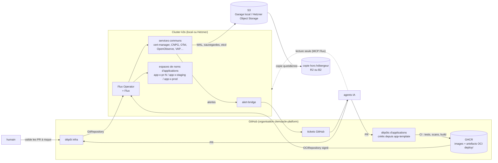

# Architecture de la plateforme

> Statut : **proposition, en attente de validation** (phase 1).
> Les choix détaillés et leurs alternatives sont dans [decisions/](decisions/). Ce document donne la vue d'ensemble.

## 1. But

Héberger plusieurs applications web sur un petit cluster k3s, piloté entièrement par Git, de façon à ce que des agents IA puissent développer, déployer et maintenir ces applications seuls, l'humain ne validant que les décisions à risque.

Trois principes guident tout le reste :

1. **Le cluster est jetable, les données ne le sont jamais.** Tout l'état du cluster se reconstruit à partir de trois sources : Git, l'état OpenTofu (chiffré) et les sauvegardes S3. Rien ne s'installe à la main.
2. **Les agents lisent le cluster, mais n'écrivent que dans Git.** Leur accès au cluster est en lecture seule et sans accès aux Secrets. Tout changement passe par une pull request, contrôlée par la CI et, selon son niveau de risque, validée par un humain.
3. **Une base, deux surcouches.** `local` vise le k3s du PC et `hetzner` vise le VPS. Tout ce qui diffère entre les deux est dans les surcouches, jamais dans la base.

## 2. Vue d'ensemble



## 3. Couches et responsabilités

| Couche | Outil | Contenu | Qui l'applique |
|---|---|---|---|
| 0. Machine | OpenTofu + kube-hetzner (Hetzner) / installation existante (local) | serveur, pare-feu, réseau, bucket, k3s, Tailscale sur l'hôte | humain : `tofu apply` |
| 1. Amorçage GitOps | OpenTofu (module `flux-operator-bootstrap`) | Flux Operator, `FluxInstance`, Secret de la clé age, accès GitHub App | humain : `tofu apply` |
| 2. Plateforme | Flux, dépôt `infra`, `cluster/base` + surcouche | opérateurs et services communs | Flux |
| 3. Déclaration des applications | Flux, `cluster/apps/<app>.yaml` | espaces de noms, quotas, règles réseau, sources et niveaux de déploiement | Flux (après PR validée) |
| 4. Applications | CI des dépôts d'applications, artefact OCI de `deploy/` | Deployment, Service, Ingress, base de données, tâches | Flux |

OpenTofu s'arrête à la couche 1. Le reste est installé par Flux, y compris les composants d'entretien (System Upgrade Controller, Kured). Pour cela, on désactive ceux que kube-hetzner installerait lui-même ([ADR-0016](decisions/0016-hetzner-kube-hetzner.md)).

## 4. Composants

Versions relevées le 2026-11-15. Elles sont figées dans le code, puis mises à jour par Renovate.

| Fonction | Composant | Local | Hetzner | ADR |
|---|---|---|---|---|
| Distribution | k3s | v1.35.10 natif (WSL2), SQLite | v1.35.x puis 1.36, embedded etcd, Leap Micro | 0016 |
| GitOps | Flux Operator 0.62 / Flux 2.10 | ✓ | ✓ | 0001 |
| Ingress | Traefik fourni par k3s / kube-hetzner | ✓ (existant) | ✓ | 0004 |
| LoadBalancer | servicelb (klipper) | ✓ (existant) | ✓ (1 nœud, sans LB payant) | 0004 |
| Stockage bloc | local-path / hcloud-volumes | local-path | hcloud-volumes | 0004 |
| Certificats | cert-manager 1.21 | CA auto-signée | Let's Encrypt DNS-01 Cloudflare | 0011 |
| DNS | external-dns 0.24 | — | Cloudflare | 0011 |
| Admission | ValidatingAdmissionPolicy + Pod Security Admission | ✓ | ✓ | 0005 |
| Secrets | SOPS + age (déchiffrement par Flux) | clé `local` | clé `hetzner` | 0007 |
| PostgreSQL | CloudNativePG 1.30 + plugin Barman Cloud 0.16 | ✓ | ✓ | 0009 |
| S3 | Garage (local) / Hetzner Object Storage | Garage | Hetzner + copie R2/B2 | 0008 |
| Observabilité | OTel Collector 0.165 → OpenObserve 1.1 | ✓ | ✓ | 0010 |
| Alertes → tickets | OpenObserve + alert-bridge (maison) | ✓ (sans envoi) | ✓ | 0014 |
| Entretien | Renovate, System Upgrade Controller 0.21, Kured 1.23, instantanés etcd | Renovate seul | ✓ | 0013 |
| Accès privé | Tailscale (hôte + opérateur) | — | ✓ | 0012 |
| CI | GitHub Actions, Trivy, Gitleaks, Semgrep, cosign | — | — | 0015 |

## 5. Structure du dépôt `infra`

```
infra/
├── tofu/
│   ├── modules/flux-bootstrap/   # commun : Flux Operator + FluxInstance + Secret age
│   ├── envs/local/               # amorce Flux sur le k3s existant (pas de serveur)
│   └── envs/hetzner/             # kube-hetzner, bucket, pare-feu, puis flux-bootstrap
├── cluster/
│   ├── base/                     # un dossier par composant, sans valeur propre à un environnement
│   │   ├── flux-system/          # FluxInstance (référence), sources Helm
│   │   ├── policies/             # ValidatingAdmissionPolicy + tests
│   │   ├── cert-manager/  cnpg/  observability/  agents-rbac/  alert-bridge/ …
│   │   └── tenants/              # composant Kustomize « application » (ns, quota, netpol)
│   ├── local/                    # surcouche : CA auto-signée, Garage, *.localhost
│   ├── hetzner/                  # surcouche : Cloudflare, external-dns, R2, Tailscale, SUC, Kured
│   └── apps/                     # une déclaration par application
├── docs/  (architecture, decisions/, runbooks/, avancement.md)
├── scripts/                      # install-tools.sh, validate.sh
├── .github/workflows/            # validation + workflows réutilisables pour les applications
├── Makefile                      # test, build, deploy, logs (+ validate, plan)
└── CLAUDE.md                     # règles pour les agents
```

Flux applique les dossiers dans un ordre explicite, avec des `dependsOn` entre ses Kustomizations : CRD et opérateurs → configuration de la plateforme → règles d'admission → applications.

## 6. Cycle de vie d'une application

Le principe est détaillé dans l'[ADR-0002](decisions/0002-livraison-applications-oci.md).

1. **Création** : un agent crée un dépôt depuis `app-template`, puis ouvre une PR sur `infra` qui ajoute `cluster/apps/<app>.yaml`. Cette déclaration réserve les espaces de noms, les quotas et les modules activés. Un humain valide l'arrivée d'une nouvelle application.
2. **Pull request sur l'application** : la CI lance les tests et les scans, puis construit l'image `ghcr.io/<org>/<app>:<sha>`. Elle publie aussi `deploy/` comme artefact OCI signé, avec le tag `pr-<n>`. Flux Operator détecte la PR grâce au label `preview` (`ResourceSetInputProvider` de type `GitHubPullRequest`) et crée `app-<app>-pr-<n>` sur `<app>-pr-<n>.<domaine>`. L'URL est commentée sur la PR. L'environnement est supprimé à la fermeture de la PR.
3. **Fusion sur `main`** : la CI publie l'artefact avec le tag `main`, et Flux déploie `app-<app>-staging`. La fusion est automatique quand les contrôles passent.
4. **Production** : une étiquette Git `vX.Y.Z` publie l'artefact avec ce tag. Le niveau production suit la plage semver `>=1.0.0` (ou `>=0.1.0`). Un agent peut poser l'étiquette si les objectifs de service du staging sont respectés depuis 24 h. Un retour arrière se fait en publiant une nouvelle étiquette depuis le commit précédent.

L'image est construite avant que l'artefact ne la référence : Flux ne voit donc jamais un manifeste qui pointe vers une image absente. Chaque artefact est signé avec cosign en mode keyless (OIDC GitHub) et vérifié par Flux.

## 7. Isolation des applications

Voir l'[ADR-0006](decisions/0006-isolation-applications.md).

- Il y a **un espace de noms par application et par niveau** : `app-<nom>-prod`, `app-<nom>-staging` et `app-<nom>-pr-<n>`. Chacun porte le label `platform.io/app=<nom>`.
- La **NetworkPolicy** refuse tout par défaut. Elle autorise trois flux : l'entrée depuis Traefik, l'export vers le collecteur OTel et le DNS. La sortie vers Internet n'est ouverte que sur demande, déclarée dans `cluster/apps/`. Le contrôleur de NetworkPolicy intégré à k3s applique ces règles.
- **ResourceQuota et LimitRange** sont posés par niveau. Les préversions ont un quota réduit, et le nombre de préversions simultanées est plafonné.
- La **Pod Security Admission** est en `restricted` sur tous les espaces de noms d'applications : pas de root, pas d'escalade de privilèges, seccomp, capacités retirées. Des **ValidatingAdmissionPolicy** ajoutent d'autres exigences : images venant de `ghcr.io/<org>/` uniquement, requests et limits obligatoires, pas de tag `latest`, pas de `hostPath`, labels exigés, et pas de Service `LoadBalancer` ou `NodePort` dans les espaces de noms d'applications.
- Chaque application déploie sous son propre ServiceAccount Flux, limité à ses espaces de noms (`serviceAccountName` sur les Kustomizations). Une application ne peut donc pas écrire ailleurs, même avec un manifeste malveillant.

## 8. Accès des agents

Voir l'[ADR-0014](decisions/0014-agents-acces-autonomie.md).

- Les agents utilisent le ServiceAccount `agent-reader` dans `platform-agents`, lié à un ClusterRole dont les règles sont explicites. Il donne `get`, `list` et `watch` sur toutes les ressources utiles (y compris les CRD Flux, CNPG et cert-manager), **sauf les Secrets**, et il interdit `pods/exec`, `pods/portforward` et `pods/attach`. Les journaux sont lisibles avec `pods/log`, et ils sont déjà masqués côté OTel.
- Un kubeconfig dédié porte un jeton à durée limitée (`kubectl create token`, 24 h), régénéré par `make agent-kubeconfig`.
- Le serveur MCP Flux (`flux-operator-mcp`) tourne avec `--read-only` et `--mask-secrets` (sa valeur par défaut), avec ce kubeconfig.
- Les agents écrivent par Git, via une GitHub App aux droits restreints (contents, pull requests, issues). Ils n'ont pas de droits d'administration.

## 9. Garde-fous humains

Les agents peuvent tout proposer. Les règles suivantes sont appliquées par la CI et par la protection des branches, pas seulement écrites ici :

| Changement | Règle | Mécanisme |
|---|---|---|
| PR sur un dépôt d'application, contrôles verts | fusion automatique | auto-merge + contrôles requis |
| Plan OpenTofu contenant une destruction ou un remplacement | validation humaine | le job `tofu-plan` analyse le plan JSON et pose le contrôle `needs-human` |
| Migration SQL avec `DROP TABLE`, `DROP COLUMN`, `TRUNCATE`, ou renommage | validation humaine | lint des migrations dans la CI de l'application |
| Montée de version mineure de k3s (Plan SUC) | validation humaine | CODEOWNERS sur `cluster/hetzner/upgrades/` + contrôle de la version |
| Nouvelle application, règles d'admission, RBAC, `tofu/` | validation humaine | CODEOWNERS sur le dépôt `infra` |
| Correctifs k3s, images, charts (Renovate) | automatique si contrôles verts, sauf versions majeures | règles Renovate |

## 10. Données et reprise après sinistre

Voir les ADR [0008](decisions/0008-stockage-objet-sauvegardes.md) et [0009](decisions/0009-postgresql-cnpg.md).

| Donnée | Protection | RPO visé | Emplacement |
|---|---|---|---|
| Manifestes, configuration | Git (GitHub) + clones locaux | 0 | GitHub |
| État OpenTofu | chiffrement natif OpenTofu, backend S3 | 0 | bucket `tfstate` (hors cluster) |
| PostgreSQL | WAL continu + sauvegarde de base quotidienne (Barman Cloud) | ≤ 5 min | bucket principal → copie R2/B2 |
| etcd (Hetzner) | instantanés k3s toutes les 6 h vers S3 | 6 h, non critique | bucket principal |
| Journaux, métriques, traces | OpenObserve sur S3, rétention 30 jours | perte acceptable | bucket principal |
| Volumes applicatifs hors base | déconseillés. Données dans PostgreSQL ou S3 | — | — |
| Secrets de départ | hors cluster et hors GitHub : clés age, phrase de chiffrement de l'état, clés de la GitHub App, jetons API | — | gestionnaire de mots de passe + copie hors ligne |

Pour reconstruire le cluster : `tofu apply`, qui crée le serveur, k3s et Flux. Flux réinstalle ensuite la plateforme, puis CNPG restaure chaque base depuis S3 (`bootstrap.recovery`). Le runbook *reconstruction complète* décrit cette séquence. Elle sera testée en local, en détruisant puis en recréant les espaces de noms.

## 11. Observabilité

- Le **collecteur OTel** reçoit le protocole OTLP des applications et collecte les journaux des pods (filelog) et les métriques de kubelet et cAdvisor. Il tourne en un seul exemplaire (DaemonSet) tant qu'il n'y a qu'un nœud.
- **Masquage** avant stockage : le processeur `redaction` bloque d'abord les valeurs qui ressemblent à des secrets (jetons GitHub `ghp_`/`gho_`, clés `AKIA…`, JWT, clés privées, `password=`) ou à des données personnelles (e-mails, numéros de carte, IBAN, téléphone). Ensuite, `transform` (OTTL) retire certaines clés : `authorization`, `cookie`, `set-cookie`, `x-api-key` et les paramètres d'URL sensibles. Les règles sont testées dans la CI sur un jeu de journaux d'exemple.
- **OpenObserve** fonctionne en mode nœud unique. Les données sont sur disque en local et sur S3 sur Hetzner. Son interface est accessible par port-forward en local, et seulement via Tailscale sur Hetzner.
- **Objectifs de service** : chaque application déclare un taux d'erreur et un temps de réponse p95, dans `deploy/slo.yaml` à partir d'un modèle. Ces objectifs deviennent des alertes OpenObserve. En cas de dépassement, alert-bridge ouvre un ticket GitHub sur le dépôt de l'application, avec dédoublonnage par empreinte.
- **Sources externes** : UptimeRobot surveille la production via l'URL publique et appelle alert-bridge par webhook, avec un secret dans l'en-tête. Les erreurs applicatives vont dans Sentry ou GlitchTip, configuré par la variable `SENTRY_DSN`.

## 12. Les trois boucles d'exploitation

1. **Incident** : alerte → ticket `incident` (alert-bridge) → un agent diagnostique en lecture seule (MCP, OpenObserve) → PR de correctif ou de retour arrière → fusion (automatique ou humaine, selon le §9) → l'alerte se résout → le ticket est fermé avec un post-mortem court.
2. **Changement** : ticket `feature`/`change` → PR → préversion → staging → étiquette de production.
3. **Entretien hebdomadaire** (le lundi, via une GitHub Action programmée qui ouvre un ticket « entretien ») : PR Renovate à trier, versions de k3s disponibles, CVE Trivy des images en production, test de restauration d'une base (automatisé chaque mois), espace disque et quotas, tickets ouverts depuis plus de 7 jours.

## 13. Budget mémoire (Hetzner, 8 Go)

Ces chiffres sont des estimations, à mesurer en local avec `kubectl top`.

| Poste | Mémoire |
|---|---|
| OS (Leap Micro) + k3s server + etcd, réservation kubelet | ~1,3 Go |
| Traefik, CoreDNS, metrics-server, CCM/CSI Hetzner | ~0,35 Go |
| Flux Operator + 4 contrôleurs (sans image-automation) | ~0,4 Go |
| cert-manager, external-dns, CNPG + plugin, SUC, Kured, Tailscale | ~0,5 Go |
| OTel Collector + OpenObserve | ~0,9 Go |
| **Total plateforme** | **~3,5 Go** |
| **Disponible pour les applications** (prod + staging + préversions) | **~4 Go** |

Conséquences :
- Kyverno n'est pas utilisé.
- Les préversions sont limitées à 2 en même temps sur Hetzner.
- La base de staging n'a qu'une instance.
- Le passage à 3 nœuds est prévu par une variable (`control_plane_count`).

## 14. Différences entre `local` et `hetzner`

| Aspect | local | hetzner |
|---|---|---|
| Domaine | `*.localhost` (résolu dans WSL) | `*.<domaine>` via Cloudflare (proxied) |
| TLS | ClusterIssuer CA auto-signée | Let's Encrypt DNS-01 Cloudflare |
| DNS | — | external-dns (Cloudflare) |
| S3 | Garage dans le cluster | Hetzner Object Storage + copie R2/B2 |
| Stockage par défaut | local-path | hcloud-volumes |
| Clé age | `age18enz…46utu` | clé `hetzner`, générée plus tard |
| Accès privé | port-forward | Tailscale |
| SUC / Kured / etcd | absents (k3s géré à la main, SQLite) | présents |
| Préversions simultanées | 5 | 2 |

## 15. Limites connues

- Le k3s local tourne sous **WSL2** : son IP change à chaque redémarrage, et les domaines `*.localhost` ne marchent que depuis WSL. Le mode réseau *mirrored* de WSL réglerait ce point, hors du périmètre de cette mission.
- Le cluster local contient des composants installés à la main pour le projet LLM. Flux ne prend en main que la release `cert-manager`, et le reste n'est pas touché. Les ValidatingAdmissionPolicy ne visent que les espaces de noms qui portent `platform.io/managed=true`, ce qui évite de casser l'existant.
- Les prix et la disponibilité des serveurs Hetzner (CX33 à environ 8,5 €/mois, CAX21 à environ 10,5 €/mois en juin 2026) sont à revérifier avant la migration. Certaines gammes ont été temporairement indisponibles en 2026.
- Hetzner Object Storage n'a pas d'API publique pour créer les clés d'accès. Il faut les créer dans la console, puis les donner à OpenTofu.
